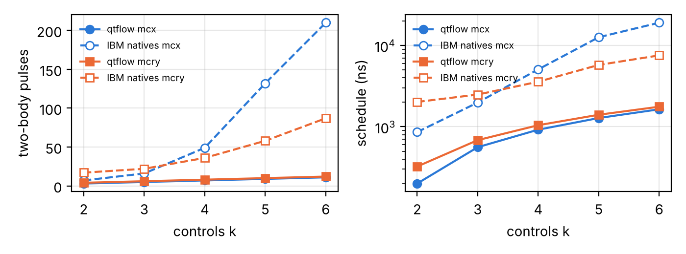

# qtflow validation report

Generated by `validation/run_validation.py` (Python 3.13.18, Qiskit 2.6.2, numpy 2.5.3).

Unit tests: `python -m pytest -q tests` (see `logs/pytest.log`).

## V1-V3  Multi-controlled gates on heavy-hex (distance 3)

`max_error`: largest entry of |U_native - e^{i phi} U_qiskit| over all basis inputs (qubit subspace); `max_leakage`: population left outside the logical qubit subspace. k = 6 is not checked (cost). IBM columns: Qiskit opt. level 3 to {rz, sx, x, cz} on the same lattice, best of 5 seeds, ASAP with sx 32 ns, cz 68 ns.

| gate | k | max_error | max_leakage | pulses | expected_pulses | swaps | duration_ns | formula_ns | ibm_cz | ibm_duration_ns |
|---|---|---|---|---|---|---|---|---|---|---|
| mcx | 2 | 0.0e+00 | 0.0e+00 | 3 | 3 | 0 | 200.0 | 200 | 7 | 860 |
| mcry | 2 | 2.8e-16 | 0.0e+00 | 4 | 4 | 0 | 324.0 |  | 17 | 2020 |
| mcrx | 2 | 2.2e-16 | 0.0e+00 | 4 | 4 | 0 | 324.0 |  | 9 | 1092 |
| mcx | 3 | 3.3e-16 | 0.0e+00 | 5 | 5 | 0 | 560.0 | 560 | 16 | 1984 |
| mcry | 3 | 2.8e-16 | 0.0e+00 | 6 | 6 | 0 | 684.0 |  | 22 | 2488 |
| mcrx | 3 | 3.1e-16 | 0.0e+00 | 6 | 6 | 0 | 684.0 |  | 22 | 2520 |
| mcx | 4 | 3.6e-15 | 0.0e+00 | 7 | 7 | 0 | 920.0 | 920 | 49 | 5076 |
| mcry | 4 | 2.0e-15 | 0.0e+00 | 8 | 8 | 0 | 1044.0 |  | 36 | 3580 |
| mcrx | 4 | 2.2e-15 | 0.0e+00 | 8 | 8 | 0 | 1044.0 |  | 36 | 3612 |
| mcx | 5 | 8.9e-16 | 0.0e+00 | 9 | 9 | 0 | 1280.0 | 1280 | 132 | 12632 |
| mcry | 5 | 1.7e-15 | 0.0e+00 | 10 | 10 | 0 | 1404.0 |  | 58 | 5760 |
| mcrx | 5 | 2.4e-15 | 0.0e+00 | 10 | 10 | 0 | 1404.0 |  | 58 | 5824 |
| mcx | 6 | nan | nan | 11 | 11 | 0 | 1640.0 | 1640 | 210 | 19068 |
| mcry | 6 | nan | nan | 12 | 12 | 0 | 1764.0 |  | 87 | 7552 |
| mcrx | 6 | nan | nan | 12 | 12 | 0 | 1764.0 |  | 87 | 7584 |

## V4  Random circuits (51 of 60 generated circuits; 3-5 qubits, 14 logical gates incl. C^k gates; circuits whose routing touched more than 10 qutrits are not checked)

- all native two-body gates on couplers: **True**
- max equivalence error: **8.2e-15**, max leakage: **7.2e-15**
- SWAPs inserted: mean 7.9, max 20

Per-circuit data: `results/v4_random_routing.csv`.

## V5  Noisy simulation (300 trajectories, 4000 shots)

Presets: reference (T1 27/17 us, Tphi 40 us), improved (100/60/150 us), ibm_like (200/100/200 us); same gate errors.

| circuit | preset | duration_ns | pulses | ideal | noisy | leakage |
|---|---|---|---|---|---|---|
| Toffoli (in 110) | reference | 232.0 | 3 | 1.000 | 0.963 | 0.020 |
| Toffoli (in 110) | improved | 232.0 | 3 | 1.000 | 0.980 | 0.013 |
| Toffoli (in 110) | ibm_like | 232.0 | 3 | 1.000 | 0.983 | 0.010 |
| C3NOT | reference | 592.0 | 5 | 1.000 | 0.880 | 0.060 |
| C3NOT | improved | 592.0 | 5 | 1.000 | 0.937 | 0.030 |
| C3NOT | ibm_like | 592.0 | 5 | 1.000 | 0.943 | 0.030 |
| C4NOT | reference | 952.0 | 7 | 1.000 | 0.830 | 0.093 |
| C4NOT | improved | 952.0 | 7 | 1.000 | 0.920 | 0.053 |
| C4NOT | ibm_like | 952.0 | 7 | 1.000 | 0.930 | 0.043 |
| C5NOT | reference | 1312.0 | 9 | 1.000 | 0.617 | 0.253 |
| C5NOT | improved | 1312.0 | 9 | 1.000 | 0.810 | 0.110 |
| C5NOT | ibm_like | 1312.0 | 9 | 1.000 | 0.847 | 0.083 |
| Grover3 m=5 | reference | 1216.0 | 12 | 0.945 | 0.803 | 0.055 |
| Grover3 m=5 | improved | 1216.0 | 12 | 0.945 | 0.861 | 0.046 |
| Grover3 m=5 | ibm_like | 1216.0 | 12 | 0.945 | 0.870 | 0.041 |

## V6  Pulse export

| circuit | schedule_ns | pulse_end_ns | channels | play | frame | qua_syntax_ok |
|---|---|---|---|---|---|---|
| Toffoli (in 110) | 232.0 | 232.0 | 10 | 13 | 0 | True |
| C3NOT | 592.0 | 592.0 | 14 | 22 | 0 | True |
| C4NOT | 952.0 | 952.0 | 18 | 31 | 0 | True |
| C5NOT | 1312.0 | 1312.0 | 22 | 40 | 0 | True |
| Grover3 m=5 | 1216.0 | 1216.0 | 10 | 83 | 42 | True |

## Pass criteria

- V1: max_error < 1e-9, leakage < 1e-9, pulses = expected, mcx duration = 360k-520 ns: **True**
- V4: all equivalent and adjacent: **True**
- V5: ideal success = 1 (Grover > 0.94) and noisy success increases with coherence: **True**
- V6: pulse end = schedule, QUA syntax valid: **True**
